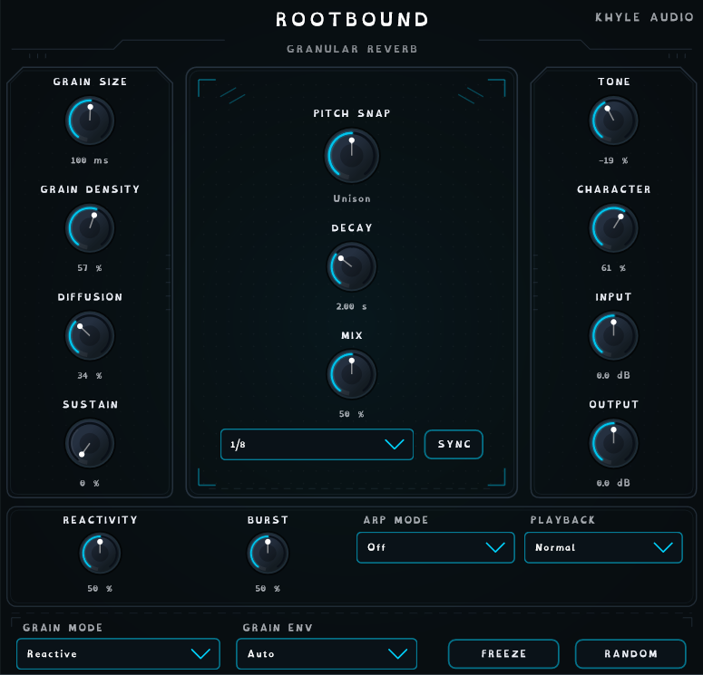

# Rootbound — Granular Reverb (Khyle Audio)

Rootbound is a granular reverb plugin (VST3 + Standalone) built with JUCE and CMake.
It combines a granular cloud engine with a dark, modulated "Blackhole-style" FDN wash.



## Signal flow
Input gain → dry (zero latency) / wet split → **2× oversampled grain engine**
(capture buffer, anti-alias mipmap, Hermite-interpolated windowed grains, Sustain bed,
pre-delayed 8-line modulated FDN wash with input diffusion, regen feedback) →
Diffuser (modulated allpasses) → Tilt EQ → Character saturator (2× oversampled) →
equal-power dry/wet mix → output gain → soft safety knee.

## Controls
| Control | What it does |
|---|---|
| Grain Size / Grain Density | Grain length (10–500 ms, tempo-syncable) and how often grains fire |
| Diffusion | Grain scatter/detune/drift, wash level and allpass smearing |
| Sustain | Steady two-grain unison bed under the cloud (0 = off) |
| Pitch Snap | Cloud interval snapped to Unison / 4ths / 5ths / octaves (±2 oct) |
| Decay | Tail length (default 4 s, tempo-syncable via SYNC) |
| Mix | Equal-power dry/wet |
| Tone / Character | Tilt EQ and tanh saturation (Character 0 = transparent) |
| Input / Output | Gain staging (±12 dB) |
| Grain Mode | Cloud, Scatter, Shimmer, Pulse, Swarm, Reactive |
| Grain Env | Auto, Smooth, Swell, Pluck grain envelopes |
| Reactive band | Reactivity, Burst, Arp Mode, Playback (active in Reactive mode) — see [REACTIVE_NOTES.md](REACTIVE_NOTES.md) |
| Freeze / Random | Hold the buffer / randomise the patch (Pitch Snap is never randomised) |

Right-click the UI for Small / Medium / Large sizes.

## Building (Windows)
Requirements: CMake ≥ 3.22, Visual Studio Build Tools 2022, JUCE at `C:/JUCE`
(or pass `-DJUCE_PATH=...`).

```bash
cmake -S . -B build
cmake --build build --config Release --target Rootbound_VST3 Rootbound_Standalone
```

Artefacts land in `build/Rootbound_artefacts/Release/`.

### Offline measurement bench (optional)
```bash
cmake -S . -B build -DROOTBOUND_BENCH=ON
cmake --build build --config Release --target RootboundBench
build/RootboundBench_artefacts/Release/RootboundBench.exe <outDir> [ab|feat|wash]
```
Runs the real DSP classes through the processor chain and prints CPU, latency,
headroom, decay (RT60 / echo density), parameter response and wash-balance
measurements, and writes A/B renders.

## Fonts
Inter, Barlow Condensed and OpenDyslexic are embedded via JUCE BinaryData
(`Assets/Fonts`). They remain under their respective authors' licenses.
